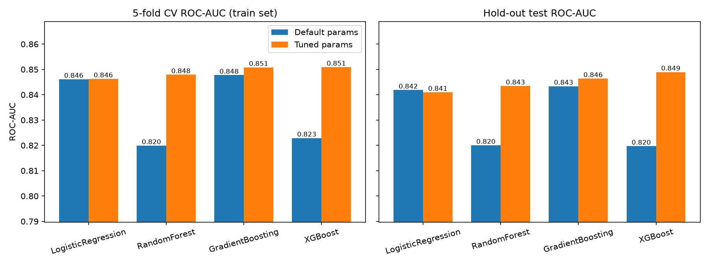
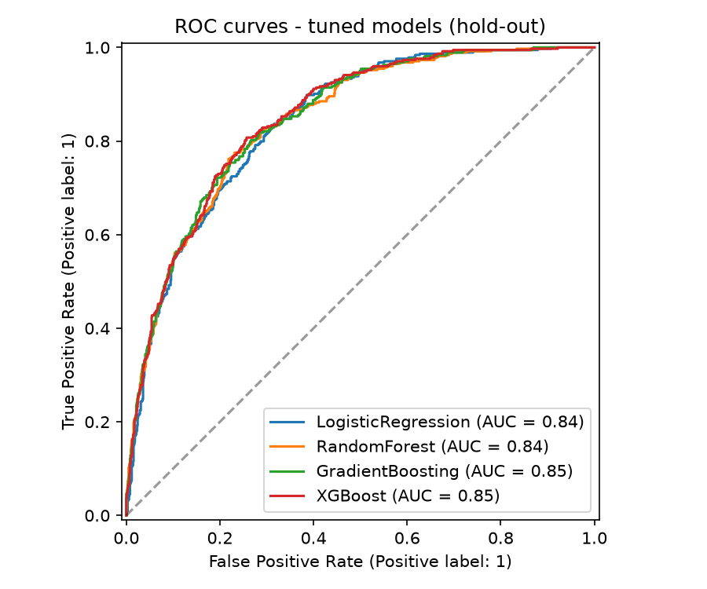
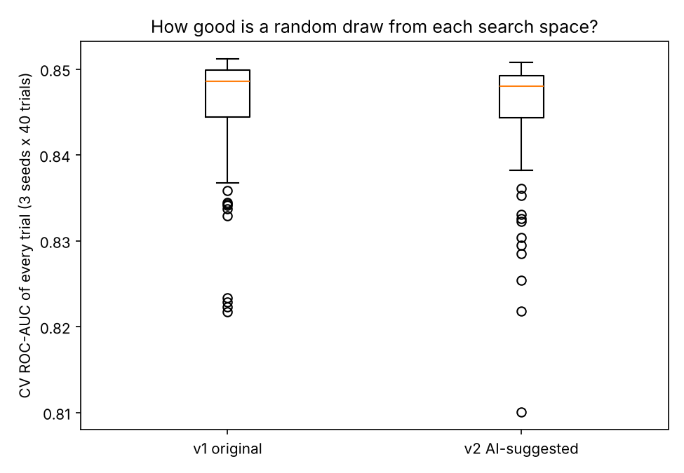
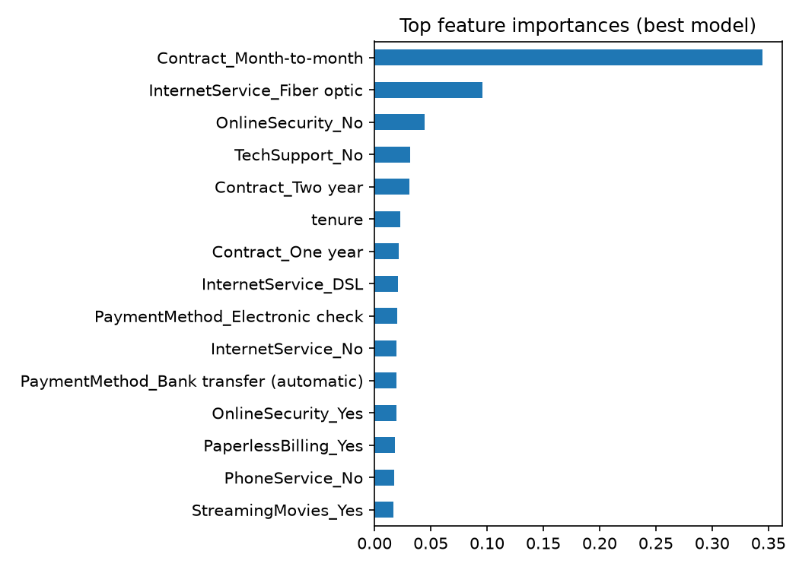
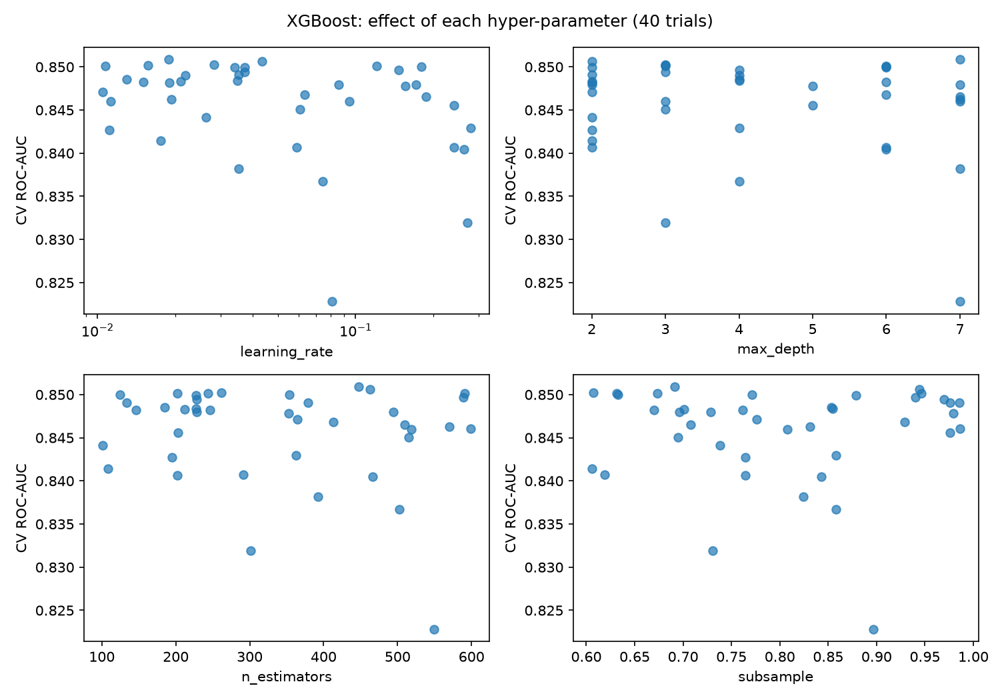

# 🎯 Model Training & Hyperparameter Tuning (XGBoost, Random Forest, Gradient Boosting)

Automated hyper-parameter optimisation with **GridSearchCV** and **RandomizedSearchCV** on a
real, imbalanced business problem: **Telco customer churn** (7,043 customers, 26.5% churn).

> **Why this matters:** default parameters rarely give the best model. In this project,
> tuning lifted XGBoost's hold-out ROC-AUC from **0.820 → 0.849** (+0.030) and turned it from
> the *weakest* tree model into the *best* one — while the whole workflow stays leak-free.

---

## ✨ What's inside

| Step | What happens |
|---|---|
| 1. Leak-free preprocessing | `Pipeline` + `ColumnTransformer` (+ custom `NumericCoercer` for dirty `TotalCharges`) re-fit inside every CV fold |
| 2. Baselines | 4 models with **default** params, 5-fold stratified CV (ROC-AUC, F1, PR-AUC) |
| 3. Tuning | `RandomizedSearchCV` for big spaces (XGBoost 40 iters, RandomForest 25 iters); `GridSearchCV` for small spaces (GradientBoosting 16 combos, LogisticRegression 8 combos) |
| 4. Honest selection | Best model chosen by **CV score only**; the hold-out test set is used once for reporting |
| 5. Reporting | Metrics JSON, full `cv_results_` CSVs, 5 plots |
| 6. Deployment-ready | One `joblib` file: raw customer row in → churn probability out |

## 📁 Structure

```
ml-hyperparameter-tuning/
├── data/telco_churn.csv
├── src/
│   ├── config.py          # paths, seeds, column groups
│   ├── data.py            # loading + single stratified split
│   ├── preprocessing.py   # NumericCoercer + ColumnTransformer
│   ├── models.py          # models + hyper-parameter search spaces
│   ├── tune.py            # baseline -> tuning -> evaluation -> save
│   ├── ai_grid_experiment.py  # v1 vs AI-suggested XGBoost space
│   ├── reporting.py       # plots
│   └── predict.py         # score new customers from the saved model
├── docs/AI_GRID_SUGGESTION.md   # prompt + AI answer for the XGBoost grid
├── tests/test_project.py  # 8 tests
├── reports/               # metrics.json, cv_results_*.csv, *.png, train_log.txt
├── models/                # best_model.joblib (git-ignored)
└── requirements.txt
```

## 🚀 Run it

```bash
python -m venv .venv && source .venv/bin/activate     # Windows: .venv\Scripts\activate
pip install -r requirements.txt

python -m pytest              # 8 tests
python -m src.tune --quick    # ~1 min smoke run
python -m src.tune            # full run (~5-8 min on a laptop)
python -m src.predict         # demo prediction on 2 raw customers
python -m src.ai_grid_experiment   # compare original vs AI-suggested XGBoost grid (~7 min)
```

Options: `--cv 5 --n-iter-xgb 40 --n-iter-rf 25`. More iterations = better chance of a good configuration.

## 🔍 Search spaces

**XGBoost (RandomizedSearchCV, 40 iterations × 5 folds = 200 fits)**

| Parameter | Distribution | Why |
|---|---|---|
| `n_estimators` | randint(100, 600) | number of boosting rounds |
| `learning_rate` | loguniform(0.01, 0.3) | log scale — it acts multiplicatively |
| `max_depth` | randint(2, 8) | model complexity |
| `min_child_weight` | randint(1, 10) | prevents tiny leaves |
| `subsample` | uniform(0.6, 1.0) | row sampling → less overfitting |
| `colsample_bytree` | uniform(0.5, 1.0) | feature sampling |
| `gamma` | uniform(0, 5) | minimum loss reduction to split |
| `reg_alpha`, `reg_lambda` | loguniform | L1 / L2 regularisation |
| `scale_pos_weight` | {1, 2.77} | handle 26.5% churn imbalance |

**Random Forest** (random): `n_estimators, max_depth, min_samples_split, min_samples_leaf, max_features, class_weight`
**Gradient Boosting** (grid, 16 combos): `n_estimators, learning_rate, max_depth, subsample`
**Logistic Regression** (grid, 8 combos): `C, class_weight`

**Rule of thumb used:** grid search when the space is small and discrete; randomized search when
it is large or continuous (it explores far more distinct values for the same budget).

## 📊 Results

Stratified 80/20 split · 5-fold CV on train · primary metric ROC-AUC.

| Model | Search | CV AUC default → tuned | **Test AUC** default → tuned |
|---|---|---|---|
| Logistic Regression | Grid (8) | 0.8461 → 0.8463 | 0.8418 → 0.8410 |
| Random Forest | Random (25) | 0.8199 → 0.8479 | 0.8200 → 0.8434 |
| Gradient Boosting | Grid (16) | 0.8477 → 0.8508 | 0.8434 → 0.8464 |
| **XGBoost** | Random (40) | 0.8229 → **0.8508** | 0.8197 → **0.8493** |

**Selected model: XGBoost.** Hold-out test: ROC-AUC **0.849**, PR-AUC 0.662, accuracy 80.3%,
precision 0.66, recall 0.54, F1 0.59 (churn class, threshold 0.5).




## 🤖 AI-assisted search-space design (XGBoost)

The task asks to *use AI to suggest hyper-parameter grids*, so I tested that properly instead of just claiming it.

1. **Prompt:** I gave an AI assistant (Claude) a fresh, explicit prompt (data size, class balance, CPU budget, search
   method). The exact prompt and its full answer are in [`docs/AI_GRID_SUGGESTION.md`](docs/AI_GRID_SUGGESTION.md).
2. **What it suggested (v2):** a *narrower* space than my original v1: `max_depth` 3-6 (v1: 2-7), `learning_rate` ≤ 0.2
   (v1: ≤ 0.3), `n_estimators` 200-800, stronger L2 (`reg_lambda` 0.5-20), a middle `scale_pos_weight` option (1.66), and a
   ranking of which parameters matter most.
3. **Fair test:** both spaces run through the same `RandomizedSearchCV` (40 trials, 5-fold CV, ROC-AUC), repeated with
   3 different search seeds (`python -m src.ai_grid_experiment`).

| Space | Best CV AUC | Mean of top-10 trials | Median trial | Test AUC of best |
|---|---|---|---|---|
| v1 original | 0.8510 ± 0.0001 | 0.8504 | 0.8486 | 0.8475 |
| v2 AI-suggested | 0.8506 ± 0.0002 | 0.8500 | 0.8480 | 0.8485 |



**Conclusion (honest):** the two spaces are **practically equivalent**. v1 is ahead by 0.0004 CV AUC and v2 by 0.001 test AUC;
both gaps are far smaller than the noise of a 1,409-row test set, so I do not claim either is better. I kept **v1 as the main
space** because model selection uses CV score, and v1's CV score is marginally higher. What I take from this:

- AI suggestions are a good **starting hypothesis** (the ranking of important parameters was useful), but they have to be
  verified with data. Here the narrower space did not beat the wider one.
- Both spaces plateau at about 0.851 CV AUC. Once the search avoids the clearly bad corners, further grid tweaking
  has diminishing returns; gains would more likely come from better features or more data.
- The narrower v2 space still produced some weak trials (lowest about 0.81 CV AUC), so narrowing alone did not remove every bad region
  (I did not investigate why).
- Provenance: v1 was also drafted with AI help during the project, so this compares two AI-designed spaces.

### Best XGBoost parameters

```json
{"n_estimators": 447, "learning_rate": 0.0189, "max_depth": 7, "min_child_weight": 7,
 "subsample": 0.691, "colsample_bytree": 0.936, "gamma": 4.02,
 "reg_alpha": 0.0266, "reg_lambda": 5.25, "scale_pos_weight": 1}
```

The search chose a **low learning rate + many trees + strong regularisation** (high `gamma`,
`min_child_weight`, `reg_lambda`) — quite different from XGBoost's defaults (which scored lower here, 0.820 test AUC).




The scatter plots show that many of the 40 trials land near 0.85 CV AUC: the gain comes mostly from
avoiding poor regions (e.g. high learning rate with deep trees), not from one magic setting.

Top drivers of churn: month-to-month contract, fibre-optic internet, no online security, no tech support.

## 🧠 Honest observations

- **Tuning helped the most where defaults were weakest** (XGBoost +0.030, Random Forest +0.023 test AUC).
- **Logistic Regression and Gradient Boosting barely changed.** Their defaults were already
  competitive, so "tuning always gives big gains" is not true.
- **Tuned XGBoost and tuned Gradient Boosting are very close** (CV AUC 0.8508 vs 0.8508; test AUC 0.849 vs 0.846).
  XGBoost was selected on its marginally higher CV AUC, but I have not run a significance test,
  so treat the gap as small.
- The decision threshold is 0.5. With 26% churners, recall (0.54) can be improved by lowering the
  threshold depending on the cost of missing a churner — see *Next steps*.

## ⚠️ Limitations / Next steps

- Try **Bayesian optimisation (Optuna)** instead of random search for the same budget.
- **Threshold tuning** using a cost matrix (cost of lost customer vs. retention offer).
- Calibrate probabilities (`CalibratedClassifierCV`) before using them as business risk scores.
- Nested CV for an even less biased estimate; multiple seeds for confidence intervals.
- Serve with FastAPI / Streamlit; track experiments with MLflow.

## 📝 License
MIT
